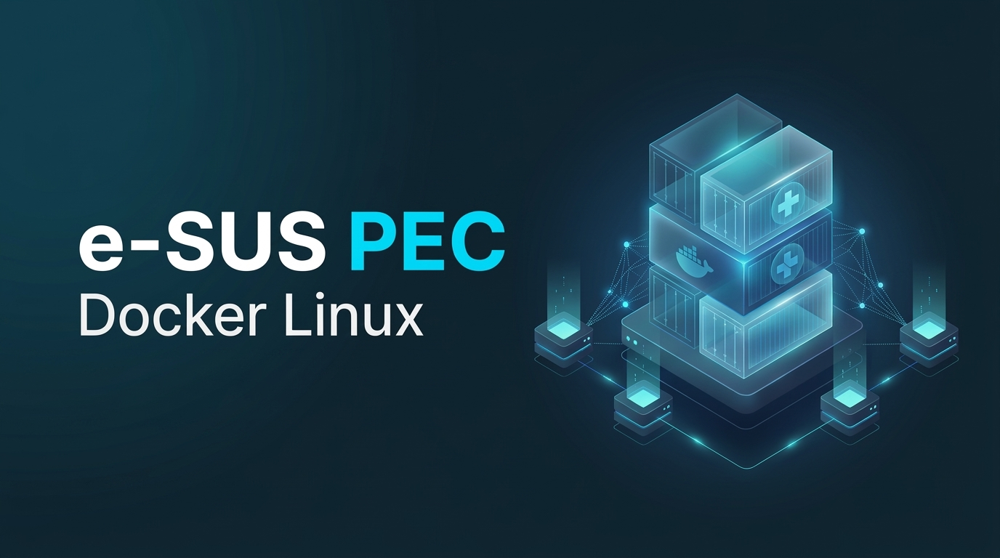

<p align="center">
  
</p>

# e-SUS APS PEC em Docker (Linux)

<p align="left">
  <a href="https://docs.docker.com/compose/"></a>
  <a href="https://adoptium.net/"></a>
  <a href="https://www.postgresql.org/"></a>
  <a href="https://spring.io/"></a>
  <a href="https://ubuntu.com/"></a>
  <a href="LICENSE"></a>
</p>

Ambiente padronizado em contêineres Docker para implantação, execução e manutenção do **e-SUS APS PEC (Prontuário Eletrônico do Cidadão)** em servidores Linux.

---

## Stacks e Tecnologias

| Camada | Tecnologia | Função no Ecossistema |
| :--- | :--- | :--- |
| **Orquestração** | Docker Engine & Docker Compose v2 | Isolamento de processos, rede bridge dedicada e controle de ciclo de vida |
| **Aplicação** | Java (OpenJDK 17 / Eclipse Temurin) | Runtime oficial do backend monolítico Spring Boot (`pec-bundle.jar`) |
| **Banco de Dados** | PostgreSQL 16 (ou 9.6) Alpine | Persistência relacional otimizada para o Data Warehouse (~1.200 tabelas) |
| **Automação** | Bash Shell Scripting | Scripts operacionais de backup, restauração e resolução de releases |
| **Segurança & SSL** | PKCS12 Keystore (`certmgr.jar`) | Gestão e renovação automática de certificados TLS na porta 443 |
| **Relatórios** | Fontconfig & Microsoft Core Fonts | Renderização vetorial e impressão consistente de receitas e espelhos SOAP em PDF |

---

## Características

- **Build multi-stage:** O `Dockerfile` extrai os artefatos oficiais da aplicação (`pec-bundle.jar`, `certmgr.jar`) diretamente do pacote instalador em tempo de compilação, gerando uma imagem de runtime enxuta (~250 MB).
- **Sem emulações de init:** Executa diretamente o executável Java do PEC (`pec-bundle.jar`), dispensando wrappers de gerenciador de inicialização do sistema operacional.
- **Tuning de PostgreSQL para APS:** Ajustes de parâmetros de memória (`shared_buffers=2GB`, `effective_cache_size=6GB`, `work_mem=32MB`) para agilizar consultas do modelo Star Schema (`tb_fat_*` e `tb_dim_*`).
- **Isolamento e LGPD:** Provisionamento automatizado do papel `esus_leitura`, com permissões estritas de `READ ONLY` e `statement_timeout` configurado para relatórios externos e auditoria.
- **Persistência desacoplada:** Volumes mapeados para configurações, chaves de transmissão da RNDS e dados de banco, permitindo atualização transparente da aplicação sem perda de estado.

---

## Requisitos

- Sistema Operacional Linux (Ubuntu 22.04 LTS ou superior recomendado)
- Docker Engine 24.0 ou superior
- Docker Compose v2.20 ou superior
- No mínimo 8 GB de memória RAM disponíveis (recomendado: 16 GB+)

---

## Instalação e Uso

### 1. Clonar o repositório e preparar o ambiente
```bash
git clone https://github.com/weesrnp/esus-pec-docker-linux.git
cd esus-pec-docker-linux
cp .env.example .env
```
Revise o arquivo `.env` para definir senhas seguras e portas conforme seu planejamento de rede.

### 2. Obter o instalador oficial do e-SUS PEC
Você pode colocar o arquivo instalador oficial (`eSUS-AB-PEC-*-Linux64.jar`) diretamente na raiz do projeto ou executar o script automatizado de download:
```bash
chmod +x scripts/*.sh docker/*.sh
./scripts/get-latest-pec.sh --download
```

### 3. Compilar e iniciar a stack
```bash
docker compose build
docker compose up -d
```
Acompanhe os logs da inicialização:
```bash
docker compose logs -f esus-pec
```
Após a conclusão do bootstrap do Spring Boot, acesse no navegador: `http://localhost:8080` (ou IP do servidor).

---

## Estrutura de Diretórios

```
esus-pec-docker-linux/
├── assets/
│   └── banner.png         # Imagem de capa do repositório
├── docker/
│   ├── Dockerfile         # Definição multi-stage da imagem da aplicação
│   └── entrypoint.sh      # Script de inicialização da JVM e checagem de banco
├── sql/
│   └── 01-init-esus-leitura.sql # Provisionamento do usuário de leitura (LGPD)
├── scripts/
│   ├── backup.sh          # Rotina de dump comprimido do PostgreSQL
│   ├── restore.sh         # Script de restauração assistida com pg_restore
│   └── get-latest-pec.sh  # Consulta e download oficial no portal SISAPS
├── docs/
│   └── POP-MIGRACAO.md    # Roteiro de migração de ambientes Windows para Linux
├── compose.yml            # Orquestração dos serviços esus-db e esus-pec
├── .env.example           # Modelo documentado de variáveis de ambiente
├── .gitignore             # Bloqueio de arquivos sensíveis, certificados e dumps
├── LICENSE                # Licença MIT
└── README.md              # Documentação oficial do projeto
```

---

## Rotinas Operacionais

### Backup do Banco de Dados
```bash
./scripts/backup.sh
```
Gera um arquivo de dump no formato customizado (`.backup`) dentro do diretório `backups/`, garantindo consistência atômica.

### Restauração de Base de Dados
```bash
./scripts/restore.sh backups/esus_backup_YYYYMMDD_HHMMSS.backup
```
O script suspende temporariamente o serviço da aplicação, executa o `pg_restore` com limpeza de schema e reativa o PEC em seguida.

### Migração de Instalação Windows para Linux
Para migrar instalações existentes rodando em Windows Server mantendo histórico clínico, cadastros e credenciais RNDS, consulte o guia passo a passo em [docs/POP-MIGRACAO.md](docs/POP-MIGRACAO.md).

---

## Boas Práticas de Segurança

- O arquivo `.gitignore` bloqueia nativamente o versionamento de credenciais (`.env`), backups (`*.backup`), certificados (`*.p12`), chaves (`*.key`) e instaladores (`*.jar`).
- Recomenda-se utilizar senhas fortes com no mínimo 24 caracteres para o usuário mestre do banco de dados.
- Mantenha a porta do banco de dados vinculada à interface local (`127.0.0.1`) ou restrita à rede interna/VPN de auditoria.

---

## Licença

Distribuído sob licença MIT. Consulte o arquivo [LICENSE](LICENSE) para mais detalhes.  
O e-SUS APS PEC é desenvolvido pelo Laboratório Bridge (UFSC) e mantido pelo Ministério da Saúde do Brasil.
